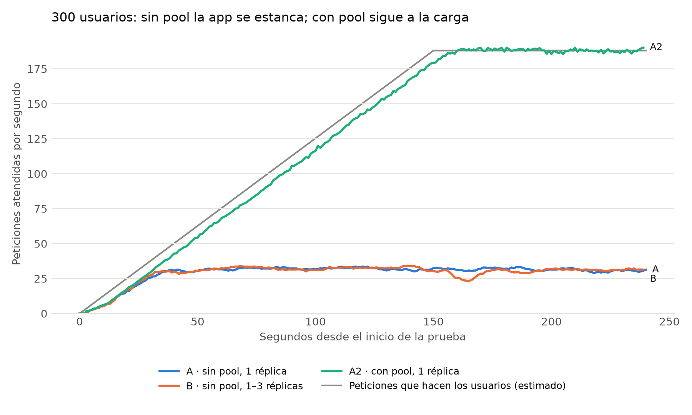
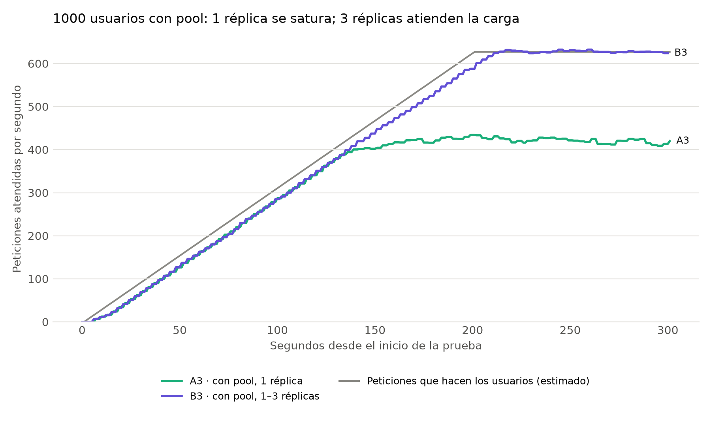
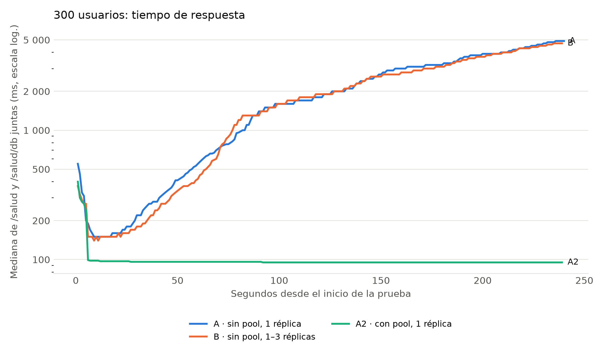
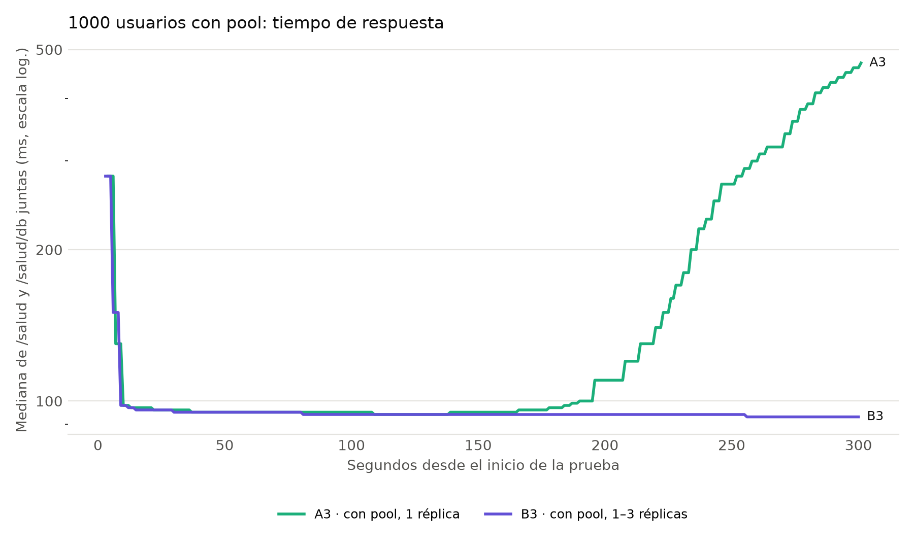

# Cineplanet Reservas — microservicio de reservas con Docker y Azure Container Apps

Prototipo académico de un servicio de reserva de asientos para cine. Se construyó con FastAPI y PostgreSQL en contenedores, se desplegó en **Azure Container Apps** con escalado automático y se midió con **Locust** en cinco escenarios de carga. Responde dos preguntas:

1. **Capacidad:** ¿qué hace falta para que el sistema aguante una preventa con cientos o miles de usuarios a la vez?
2. **Corrección:** al haber muchas compras simultáneas, ¿cómo se evita vender dos veces el mismo asiento (condición de carrera)?

> **Aviso:** proyecto académico del curso *Sistemas Operativos* (USIL, 2026-2, Grupo 2). No está afiliado a Cineplanet ni a Cineplex S.A. Todos los datos (películas, funciones, asientos) son **datos de prueba ficticios**. No se usaron datos internos de Cineplanet.

## Resultado principal

> **Antes de escalar hay que medir dónde está el cuello de botella.**

Con una conexión nueva a la base de datos por cada petición, la app se estancó en unas 30 peticiones por segundo y **agregar réplicas no ayudó**: la base estaba al 92 % de CPU. Con un **pool de conexiones**, la base bajó al 15 % y la espera volvió a ~95 ms. Recién entonces el límite pasó a ser la réplica, y **escalar a 3 réplicas sí permitió atender a 1000 usuarios**.

| Escenario | Pool | Réplicas | Usuarios | Rendimiento sostenido (total) | Mediana de `/salud/db` | Qué limitaba |
|---|---|---|---|---|---|---|
| A | No | 1 | 300 | ~30 req/s | 8000 ms | La base (CPU al 92 %) |
| B | No | 1–3 | 300 | ~30 req/s | 6100 ms | La base (escalar no mejoró) |
| A2 | Sí | 1 | 300 | ~188 req/s (toda la carga) | 95 ms | Nada: sin fila (base al 15 %) |
| A3 | Sí | 1 | 1000 | ~420 req/s | 670 ms | La réplica (CPU al tope) |
| B3 | Sí | 1–3 | 1000 | ~627 req/s (toda la carga) | 94 ms | Nada: sin fila |

- "Rendimiento sostenido" es lo que se ve en los gráficos con todos los usuarios activos. Los promedios de la tabla de Locust incluyen la rampa de subida y son menores (A3: 327 req/s; B3: 418,6 req/s).
- Los ~95 ms de mediana son, sobre todo, el viaje de red entre Lima (donde corría Locust) y Brazil South (São Paulo).
- A, B, A2 y A3 terminaron con 0 fallos. B3 tuvo 122 errores `502 Bad Gateway` (0,10 %), probablemente mientras las réplicas arrancaban o se apagaban (hipótesis no verificada).

### Gráficos

La línea gris es una **estimación** de las peticiones que generan los usuarios (usuarios × ~0,63 peticiones/s). Si la línea de un escenario va pegada a la gris, el sistema atiende a todos; si queda por debajo, se forma una fila.

| 300 usuarios | 1000 usuarios |
|---|---|
|  |  |
|  |  |

La mediana de los gráficos combina `/salud` y `/salud/db` (el historial por segundo de Locust solo se guardó agregado), por eso es menor que la mediana de `/salud/db` de la tabla.

## Doble venta: la condición de carrera y su corrección

`scripts/carrera.py` lanza **50 compras simultáneas del mismo asiento** (50 hilos que salen a la vez gracias a una `threading.Barrier`).

| Ruta | Cómo vende | Ventas del mismo asiento |
|---|---|---|
| `POST /reservas/insegura` | Comprueba que está libre, espera 0,5 s y vende | **40** sin pool · **10** con pool |
| `POST /reservas/segura` | Igual, pero con `SELECT ... FOR UPDATE` | **1** |

- La pausa de 0,5 s amplía **a propósito** la ventana entre "comprobar" y "vender" para que la carrera sea reproducible. Sin la pausa, en las pruebas locales la carrera no apareció. La ruta segura tiene la misma pausa y aun así vende una sola vez.
- `FOR UPDATE` bloquea la fila del asiento hasta el `COMMIT`: las demás compras esperan, leen "vendido" y reciben `409`. Es la misma idea que `acquire()` y `release()` de un lock en xv6.
- El pool redujo la doble venta (40 → 10) pero **no la evita**: limita cuántas transacciones corren a la vez (como un semáforo con contador de 10), no da exclusión mutua. Solo el candado (`FOR UPDATE`) la da.
- Que fueran 40 sin pool probablemente se debe al pool de 40 hilos que FastAPI usa para las rutas síncronas (no verificado).

## Arquitectura

### Despliegue en Azure (medido)

```
   Locust (Mac en Lima) / navegador
                 │ HTTPS
                 ▼
   ┌───────────────────────────────┐
   │  Ingress de Container Apps    │  balanceador administrado
   └──────┬──────────┬──────────┬──┘
          ▼          ▼          ▼
     ┌────────┐ ┌────────┐ ┌────────┐
     │reservas│ │reservas│ │reservas│  1 a 3 réplicas (0,25 vCPU, 0,5 GiB)
     │ pool 10│ │ pool 10│ │ pool 10│  escalan con la concurrencia HTTP
     └───┬────┘ └───┬────┘ └───┬────┘
         └──────────┼──────────┘
                    ▼  SSL obligatorio
   ┌───────────────────────────────┐
   │ Azure Database for PostgreSQL │  Flexible Server B1MS (1 vCore)
   │ Flexible Server               │  firewall: IP propia + servicios de Azure
   └───────────────────────────────┘
```

La imagen se construye en la Mac para `linux/amd64`, se guarda en **Azure Container Registry** y Container Apps la descarga desde ahí. La app y la base están en la región **Brazil South** (la suscripción de estudiante solo permite algunas regiones y Chile Central no tenía capacidad para la base).

El despliegue en Azure fue temporal: los recursos se eliminan después de la exposición del curso.

### Entorno local (Docker Compose)

```
   curl / scripts/carrera.py / Locust
                 │ localhost:8000
                 ▼
          ┌─────────────┐
          │  reservas   │  FastAPI + uvicorn
          └──────┬──────┘
                 │ red interna de Compose (nombre "db")
          ┌──────┴──────┐
          │     db      │  PostgreSQL 18.6, volumen persistente
          └─────────────┘
```

### Rutas de la API

| Método y ruta | Qué hace |
|---|---|
| `GET /salud` | Responde `{"estado":"ok"}` sin tocar la base |
| `GET /salud/db` | Cuenta los asientos en la base: `{"estado":"ok","asientos":10}` |
| `POST /reservas/insegura` | Vende un asiento sin sincronización (demo de la condición de carrera) |
| `POST /reservas/segura` | Vende un asiento con `SELECT ... FOR UPDATE` |

Las rutas de reserva reciben `{"asiento_id": 1, "cliente": "ana"}` y responden `200` (vendido), `404` (asiento inexistente) o `409` (ya vendido). La documentación interactiva está en `http://localhost:8000/docs`.

## Tecnologías

- **Python 3.13**, **FastAPI**, **uvicorn** y **Pydantic**
- **PostgreSQL 18.6** con **psycopg 3** (sin ORM) y **psycopg_pool**
- **Docker** y **Docker Compose**; `docker buildx` para imágenes `linux/amd64`
- **Azure Container Apps**, **Azure Container Registry**, **Azure Database for PostgreSQL – Flexible Server** y **Azure Monitor** (métricas)
- **Locust** (pruebas de carga), **pandas** y **matplotlib** (gráficos)

## Cómo ejecutarlo en local

Requisito: [Docker Desktop](https://www.docker.com/products/docker-desktop/) instalado y abierto.

```bash
git clone https://github.com/gianfrancobaca/cineplanet-reservas.git
cd cineplanet-reservas
cp .env.example .env    # completa usuario, contraseña y nombre de la base
docker compose up --build -d
docker compose ps       # db debe aparecer como "healthy"
```

`reservas` espera a que la base pase su chequeo de salud (`pg_isready`) antes de arrancar. En el primer arranque, `db/init.sql` crea las tablas y carga 10 asientos de prueba.

Comprueba la API:

```bash
curl localhost:8000/salud       # {"estado":"ok"}
curl localhost:8000/salud/db    # {"estado":"ok","asientos":10}
```

### Reproducir la doble venta

Los ejemplos usan los valores de `.env` (aquí `cineplanet` y `reservas_db`; cámbialos si usaste otros). Hace falta Python 3 en el equipo; el script solo usa la biblioteca estándar.

```bash
# 1. Dejar todos los asientos libres
docker compose exec db psql -U cineplanet -d reservas_db -c "TRUNCATE ventas RESTART IDENTITY; UPDATE asientos SET estado = 'libre';"

# 2. Lanzar 50 compras simultáneas del asiento 1
python3 scripts/carrera.py insegura

# 3. Ver cuántas veces se vendió
docker compose exec db psql -U cineplanet -d reservas_db -c "SELECT asiento_id, count(*) FROM ventas GROUP BY asiento_id;"
```

Repite los tres pasos con `segura` en lugar de `insegura`. El número exacto de la insegura puede variar entre corridas; lo importante es "más de una venta" frente a "una sola".

### Prueba de carga en local (solo para validar el script)

```bash
python3 -m venv .venv && source .venv/bin/activate
pip install -r requirements-dev.txt
locust -f carga/locustfile.py --host http://localhost:8000 --headless -u 50 -r 10 -t 1m
```

En local, Locust y la API comparten la CPU del mismo equipo, así que esta prueba no mide capacidad.

### Detener

```bash
docker compose down      # borra los contenedores; los datos se conservan en el volumen
docker compose down -v   # también borra el volumen (y vuelve a ejecutarse init.sql en el próximo arranque)
```

## Cómo se desplegó en Azure (resumen)

Pasos seguidos con Azure CLI y una suscripción Azure for Students. Los nombres van en variables de shell; ninguna contraseña está en el repositorio.

```bash
# Imagen linux/amd64 en Azure Container Registry
az acr login --name $ACR
docker buildx build --platform linux/amd64 --provenance=false \
  -t $ACR.azurecr.io/reservas:v2 --push ./servicios/reservas

# Esquema en el servidor PostgreSQL administrado (una sola vez)
docker run --rm -it -v "$PWD/db/init.sql:/init.sql:ro" postgres:18.6-trixie \
  psql "host=$PG_HOST port=5432 dbname=reservas_db user=cineplanet sslmode=require" -f /init.sql

# Escalado de la app: 1 a 3 réplicas, una más cada 10 peticiones simultáneas
az containerapp update -n reservas -g $RG \
  --min-replicas 1 --max-replicas 3 \
  --scale-rule-name http-concurrencia --scale-rule-type http --scale-rule-http-concurrency 10

# Prueba de carga contra Azure (escenarios A3 y B3)
locust -f carga/locustfile.py --host $URL --headless -u 1000 -r 5 -t 5m --processes 4 \
  --csv carga/resultados/azure_b3_escalado_pool_1000
```

Detalles que costaron tiempo:

- **`--provenance=false` es obligatorio:** sin él, `buildx` agrega un manifiesto `unknown/unknown` y Container Apps rechaza la imagen.
- **Cada cambio de código lleva una etiqueta nueva** (`v1` sin pool, `v2` con pool), nunca `latest`.
- **Las ACR Tasks (`az acr build`) no están disponibles en Azure for Students**, por eso la imagen se construye en la Mac.
- **La contraseña de la base va como secreto** de Container Apps (`--secrets` + `secretref:`), no como variable de entorno en texto plano.
- **El número de réplicas está limitado por la base:** B1MS admite 50 conexiones y Azure reserva algunas; con 3 réplicas × pool de 10 se midieron 38–39 conexiones activas.

## Estructura del repositorio

```
cineplanet-reservas/
├── docker-compose.yml         # servicios reservas y db, healthcheck y volumen
├── .env.example               # plantilla de credenciales (sin valores reales)
├── requirements-dev.txt       # herramientas que no van en la imagen: Locust, pandas, matplotlib
├── db/
│   └── init.sql               # tablas y datos de prueba
├── servicios/
│   └── reservas/
│       ├── Dockerfile
│       ├── requirements.txt   # dependencias con versiones fijas
│       └── app/
│           └── main.py        # API FastAPI con el pool de conexiones
├── scripts/
│   └── carrera.py             # 50 compras simultáneas del mismo asiento
└── carga/
    ├── locustfile.py          # usuarios simulados: GET /salud (peso 1) y /salud/db (peso 3)
    ├── graficos.py            # genera los 4 gráficos a partir de los CSV de Locust
    └── graficos/              # gráficos de las mediciones en Azure
```

`carga/graficos.py` lee los CSV de `carga/resultados/`, que no están en el repositorio (`.gitignore`); se ejecuta desde la raíz con `python carga/graficos.py`.

## Decisiones de diseño

- **Pool de conexiones por réplica (`min_size=2`, `max_size=10`):** PostgreSQL crea un proceso por cada conexión, y además cada conexión nueva implica cifrado SSL y verificación de contraseña. Reutilizar conexiones fue lo que liberó la CPU de la base. El tamaño se eligió para que 3 réplicas no superen el límite de conexiones del servidor.
- **`SELECT ... FOR UPDATE` para la exclusión mutua:** el candado vive en la base, que es lo único compartido por todas las réplicas; un lock dentro de un proceso de Python no protegería entre réplicas. Alternativas evaluadas: `UPDATE ... WHERE estado = 'libre'` (comprobar y vender en una sola operación atómica) y una restricción `UNIQUE (asiento_id)` en `ventas`.
- **`ventas` sin `UNIQUE (asiento_id)` a propósito:** para que la ruta insegura deje rastro de cada doble venta y se pueda contar.
- **Nginx reemplazado por el ingress de Container Apps:** en Azure, el ingress ya reparte las peticiones entre réplicas, así que un balanceador propio no aportaba a la demo. Por el mismo motivo se descartó un segundo servicio (`catalogo`).
- **Locust mide `/salud` y `/salud/db`, no las rutas de reserva:** las rutas de reserva tienen la pausa de demo de 0,5 s, que distorsionaría la medición. En una preventa, la mayor parte del tráfico es consultar disponibilidad (lecturas), y `/salud/db` consulta la base como lo haría esa lectura.
- **Rutas síncronas (`def`) con psycopg 3:** el driver es bloqueante; con `def`, FastAPI ejecuta cada petición en un hilo de su pool y no bloquea el bucle de eventos.
- **PostgreSQL 18.6 (`trixie`), versiones fijadas con `==`:** entorno reproducible; Debian coincide con la base de `python:3.13-slim`.
- **Puerto 5432 sin publicar en local:** la base solo es accesible desde la red interna de Compose.
- **Una sola base compartida:** simplifica el prototipo y es lo que permite que el bloqueo funcione entre réplicas. Es también su límite de capacidad.

## Limitaciones

- **Medición:** Locust corrió desde una sola Mac en Lima, así que la latencia de red (~95 ms) se suma a todos los resultados. Los usuarios de Locust esperan sin límite de tiempo y no piden otra cosa hasta recibir respuesta, por lo que la carga se autolimita (un usuario real abandonaría tras varios segundos). La línea gris de los gráficos es una estimación propia.
- **Infraestructura pequeña:** base B1MS de 1 vCore y réplicas de 0,25 vCPU. Los números valen para esta configuración, no para un sistema real de Cineplanet.
- **Errores 502 durante el escalado** (0,10 % en B3): una sonda de disponibilidad (*readiness probe*) en `/salud/db` probablemente los reduciría.
- **Seguridad:** la app usa el usuario administrador de la base; la regla de firewall "servicios de Azure" admite cualquier recurso de Azure (en producción: red virtual privada); Container Apps lee el registro con el usuario administrador del ACR (mejor: identidad administrada). Las credenciales locales son de prueba.
- **Alcance:** es un prototipo que demuestra y mide una estrategia; no reproduce el sistema de Cineplanet. Una solución completa para preventas añadiría una sala de espera virtual, retención temporal del asiento con expiración y caché de lecturas.

## Relación con Sistemas Operativos

| Concepto del curso | Dónde aparece en el proyecto |
|---|---|
| Proceso y PID | Cada contenedor ejecuta un proceso principal; uvicorn es el PID 1 de su contenedor |
| Un proceso por cliente | PostgreSQL crea un proceso por conexión; `pg_stat_activity` muestra los mismos PID reutilizados por el pool |
| Aislamiento | Los contenedores usan *namespaces* y *cgroups* del kernel Linux |
| Máquinas virtuales y arquitectura de CPU | Docker Desktop usa una VM Linux en macOS; la imagen se construye para x86-64 (`linux/amd64`) emulando esa CPU |
| Sistemas de archivos y montajes | El volumen sobrevive al contenedor; `init.sql` se monta como archivo de solo lectura |
| Comunicación entre procesos | Socket Unix dentro del contenedor de la base vs. TCP en la red de Compose |
| Condición de carrera | 50 compras simultáneas del mismo asiento en la ruta insegura |
| Exclusión mutua | `SELECT ... FOR UPDATE` como `acquire`/`release`; la transacción espera dormida, como un *sleeplock* |
| Semáforo con contador | El pool de conexiones: 10 permisos por réplica; si no queda ninguno, el hilo espera |
| Planificación | Hilos del sistema en `carrera.py` (apropiativa) vs. *greenlets* de Locust (cooperativa) |
| Recursos y cuellos de botella | Escalar la capa sin estado no sirve si el recurso compartido (la base) está saturado |

## Próximos pasos

- GitHub Actions para construir y publicar la imagen en cada cambio.
- Identidad administrada para que Container Apps lea el registro sin usuario administrador.
- Sonda de disponibilidad y análisis de los 502 en Log Analytics.
- Repetir la demo de doble venta en Azure con 3 réplicas.

## Autor

**Gianfranco Baca** — responsable del bloque de tecnología (microservicios con Docker y despliegue en Azure) del Grupo 2.
GitHub: [@gianfrancobaca](https://github.com/gianfrancobaca) · LinkedIn: [gianfrancobaca](https://www.linkedin.com/in/gianfrancobaca)